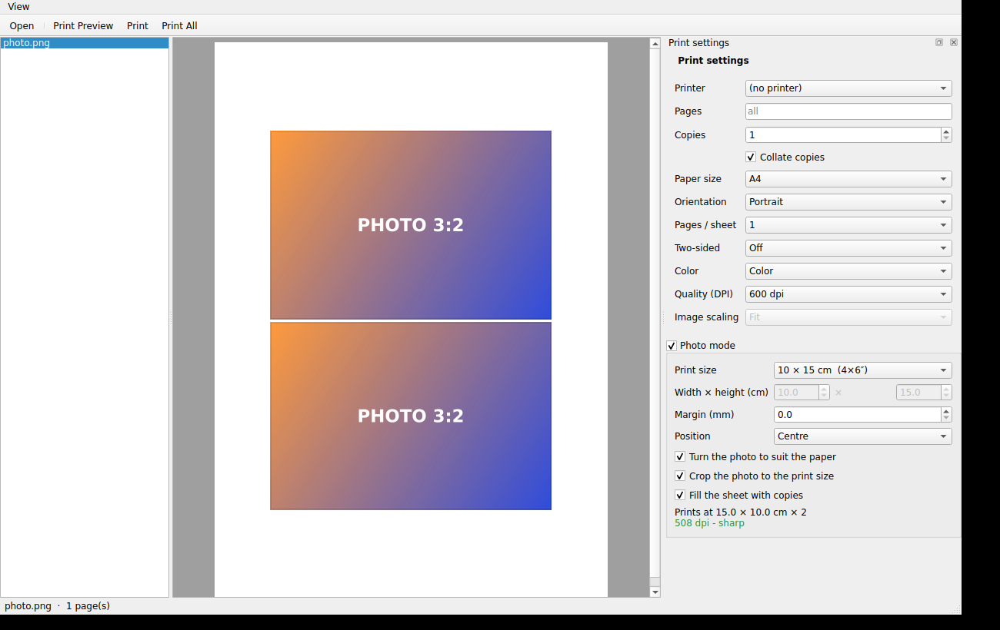

# PrintHub — in the linux-scripts toolkit

> This folder is PrintHub **inside the toolkit**: the same code as the standalone project, plus a launcher and an
> `install.sh` target. The rest of this file is PrintHub's own README.

```bash
./install.sh printhub            # copies the app; uses the system's PySide6, else makes a private venv (~200 MB)
printhub [file.pdf ...]          # or from the menu / drop files on the window
./install.sh --uninstall printhub
```

`printhub` is **not part of `./install.sh all`** because of the Qt download. Minimal systems need the usual Qt runtime
libraries (Debian/Ubuntu: `libegl1 libgl1 libxkbcommon0 libfontconfig1 libdbus-1-3 libgssapi-krb5-2`; a normal desktop has them).

How it fits with the other tools: **printer-setup** finds the driver and adds the printer; **PrintHub** prints files to it
(its “Open PrintHub” button is in printer-setup's step 5). The language you pick in any toolkit app is remembered in
`~/.config/linux-scripts/lang` and used by PrintHub on its first start (set `PRINTHUB_STANDALONE=1` to ignore it).

Tests (need PySide6; offscreen, no printer): `for t in tests/*.py; do QT_QPA_PLATFORM=offscreen python $t; done` —
they use a separate settings store (`PRINTHUB_SETTINGS`) and never touch your saved preferences; `PRINTHUB_SHOTS=docs`
refreshes the README screenshots.

---

# PrintHub

A universal, cross-platform **print front-end** — the piece the Linux
desktop is missing and Windows/macOS never unified either: open *any* common
file, preview it, and print it through the OS's own print dialog with full
settings.

> Prototype. PDF and images work with zero external dependencies. Office
> documents need LibreOffice installed (used headless for conversion).

A right-hand **Print settings** panel exposes the common parameters directly:
page range, copies, collate, paper size, orientation, pages-per-sheet (N-up),
two-sided, color/grayscale and image scaling. These seed the OS print dialog,
so anything driver-specific (output quality, paper type, binding) is still one
click away in the native dialog itself.

The **View** menu switches language (English / ქართული) and theme (Light /
Dark). Defaults are English and light; both choices persist via `QSettings`.
Translations live in a plain dict in `printhub/i18n.py` — no `.ts/.qm`
toolchain needed to add a language.

## Photo mode



Printing a photo is not printing a document page: the paper *is* the print, the photo should reach the edges (or sit at an
exact size), and the preview must be what comes out. Images used to be laid on an A4 stand-in page, which was then shrunk
into the printable area of whatever paper was chosen — hence the white bands. **Photo mode** (a checked box in the settings
panel, on by default for images) lays the photo out directly on the chosen paper, in millimetres:

| Print size | What happens |
|---|---|
| **Fill the paper** | the photo covers the whole paper (inside the margin); the overflow is cut, and the panel says how many % |
| **Whole photo** | nothing is cut; margins show on the sides where the proportions differ |
| **9×13, 10×15 (4×6″), 13×18 (5×7″), 15×21, 20×25 (8×10″), 20×30 cm, or your own** | an exact print size, centred or in the top-left corner; *Crop to the print size* (on) fills that size, off puts the whole photo inside it; *Fill the sheet with copies* prints as many as fit (two 10×15 on an A4) |
| **Actual size** | the photo's own physical size from the DPI stored in the file |

* **Margin** (mm) around the photo; **Turn the photo to suit the paper** turns a landscape photo on portrait paper (and the
  other way round) instead of cropping or shrinking it. The camera's rotation (EXIF) is applied.
* The panel shows the resulting **print size and resolution** (green ≥ 240 dpi, amber ≥ 150, red below: "will look soft") and what is cut off.
* The **preview** (central view, Print Preview) and the **print** use the same two functions (`photo.layout_photo`,
  `photo.paint_layout`); the print is painted from the original file, not from a re-rendered PDF, on the *full* paper, so a
  photo can reach the paper's edge. The layout follows the paper the printer actually ends up with, also when you change it in the native dialog.
* **Borderless**: the program places the photo exactly to the paper's edge, but whether the printer prints to the edge is the
  driver's decision. Pick the printer's **borderless paper size** (it appears in the *Paper size* list, e.g. "4x6 (Borderless)")
  and use *Fill the paper* with margin 0; with a normal paper size the printer leaves its own few-millimetre border.
* Each photo gets a sheet of its own (N-up applies to documents); with *Print All*, photos and documents can be mixed in one job.
  Switch the box off to get the old image behaviour (A4 stand-in, *Image scaling*).

`tests/test_photo.py` checks the geometry as numbers and the printing on pixels (a PDF printer, corners and margins probed);
`tests/test_photo_ui.py` drives the window.

## Why Qt / PySide6

Printing is the hard part to make portable, and Qt already solved it:
`QtPrintSupport` maps one API onto **GDI (Windows)**, **Cocoa (macOS)** and
**CUPS (Linux)**. The same code shows the native print dialog, page setup and
preview everywhere. PySide6 is the official, **LGPL** Qt for Python — friendly
to contributors and downstream packaging.

## How it works

```
file ──► normalize to PDF ──► QtPdf preview ──► QPrintDialog ──► OS print stack
          (convert.py)          (QPdfView)       (native)        (GDI/Cocoa/CUPS)
```

* **PDF** → used as-is
* **Images** (PNG/JPG/TIFF/…) → in **photo mode** laid out directly on the chosen paper (see below); otherwise onto an auto-oriented A4 page (`QPdfWriter`)
* **Office/text** (DOCX/XLSX/ODT/…) → `libreoffice --headless --convert-to pdf`

Everything funnels through one printing function (`printing.py`), so the real
print, the preview, and the headless test share exactly one code path. That
core takes a flat list of `(document, page)` leaves, so a **batch queue** of
many files prints as one job — drop several files in, arrange them in the left
panel, and hit **Print All**.

## Run

```bash
python -m venv .venv
# Windows: .venv\Scripts\activate   |   Linux/macOS: source .venv/bin/activate
pip install -r requirements.txt
python run.py                 # or:  python run.py path/to/file.pdf
```

`run.py` works from any directory. `python -m printhub` also works, but only
when the current directory is this project root (so `printhub` resolves to the
inner package).

## Headless self-test

Exercises convert → QtPdf → QPrinter (printing to a PDF file), no display or
printer needed:

```bash
QT_QPA_PLATFORM=offscreen python tests/smoke.py
```

## Packaging

Each OS builds its own installer from the same `run.py` via PyInstaller. The
`.github/workflows/build.yml` matrix does all three on a tag push (`vX.Y.Z`)
and attaches the artifacts to a GitHub release.

| Platform | Command | Output |
|----------|---------|--------|
| Linux    | `packaging/linux/build-deb-rpm.sh` (needs `fpm`, `rpm`) | `.deb` + `.rpm` |
| Windows  | `packaging\windows\build-windows.ps1` (needs Inno Setup) | `PrintHub-*-Setup.exe` |
| macOS    | `packaging/macos/build-app-dmg.sh` | `PrintHub.app` + `.dmg` |

A `.desktop` file, AppStream metainfo and a Flatpak manifest live under
`packaging/linux/`. LibreOffice is never bundled — it stays an optional system
dependency (a Recommends on Debian), so the packages remain small and the
PDF/image paths work with nothing else installed.

## Project layout

| File | Role |
|------|------|
| `printhub/convert.py`   | any file → PDF (the "last mile" per format) |
| `printhub/printing.py`  | render a `QPdfDocument` onto a `QPrinter` |
| `printhub/mainwindow.py`| open / drag-drop / preview / print UI |
| `printhub/__main__.py`  | entry point |
| `tests/smoke.py`        | headless end-to-end check |

## Roadmap

* ~~Page-range and copies surfaced in-app~~ ✓ (toolbar: `Pages` + `Copies`)
* ~~N-up and duplex surfaced in-app~~ ✓ (`Per sheet`: 1/2/4/6/9/16, `2-sided`)
* ~~Fit / fill / actual-size scaling for images~~ ✓ (`Image` combo, re-lays live)
* ~~Batch queue (drop many files, print in order)~~ ✓ (left panel, `Print All`)
* ~~deb/rpm + Windows installer + .app/.dmg packaging matrix~~ ✓ (`packaging/`, CI)
* Sandboxed conversion; per-file settings in the batch queue; printer presets

## License

MIT (code). PySide6 is LGPL-3.0; LibreOffice, if used, is MPL-2.0.
